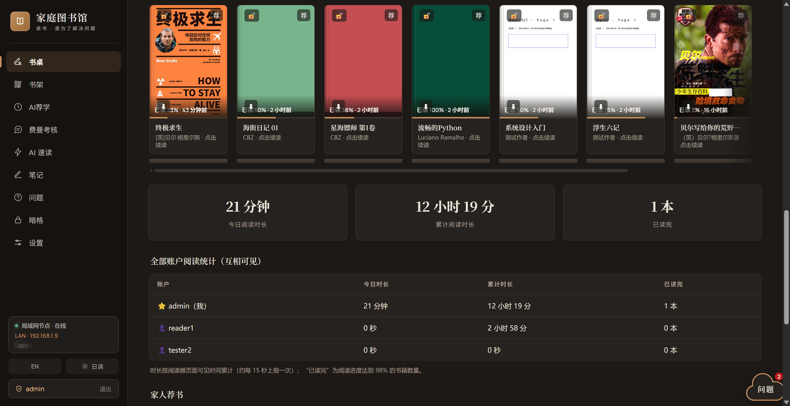
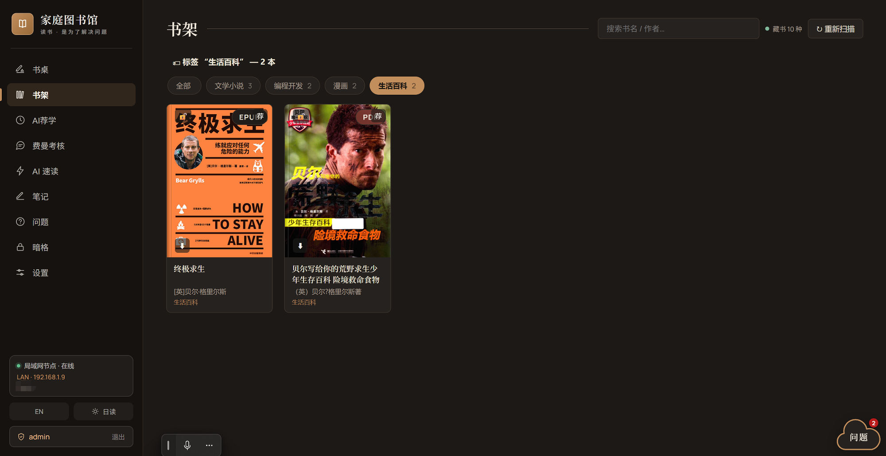
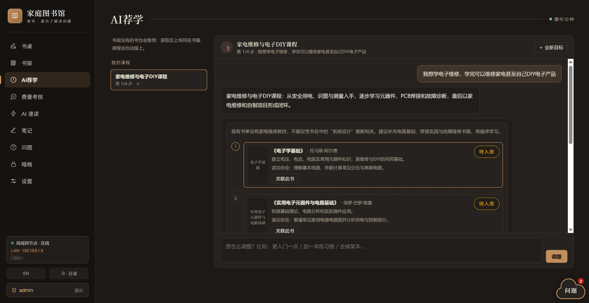
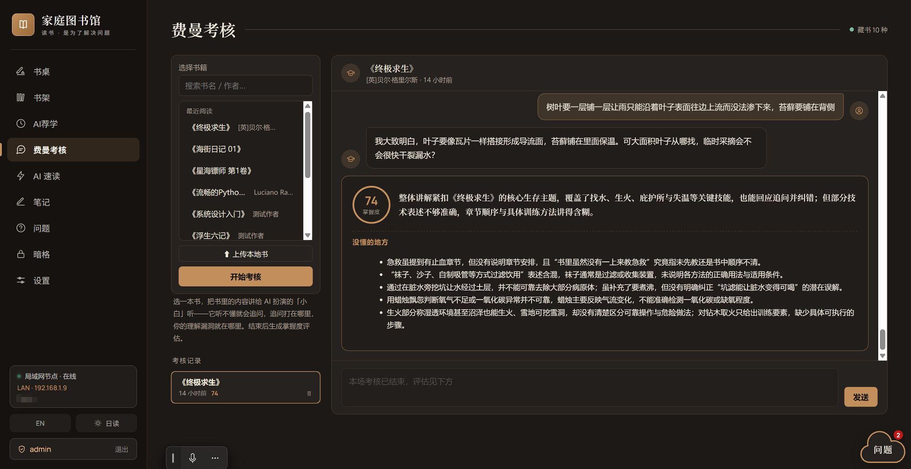
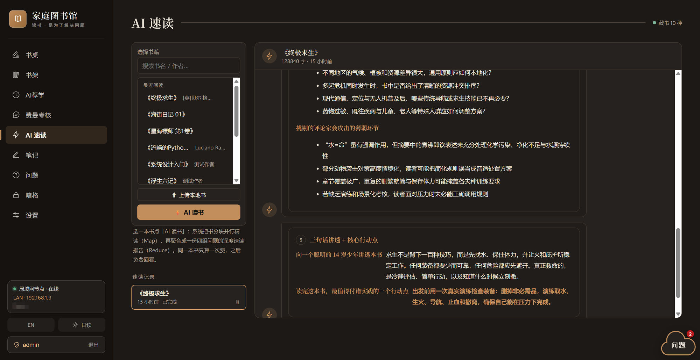
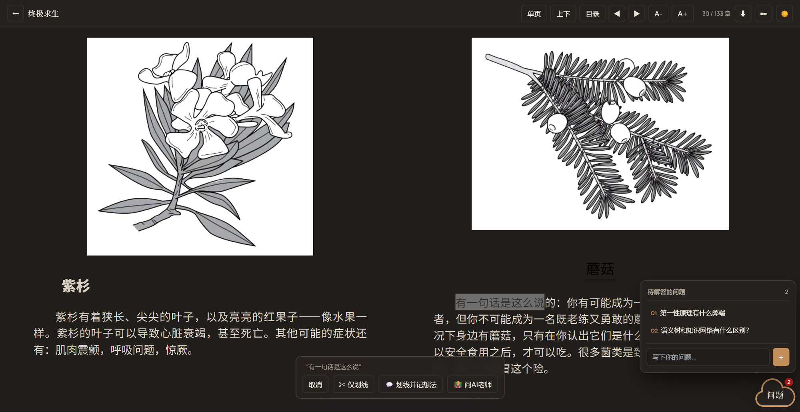

# 📚 家庭图书馆 · 局域网知识管理系统

**Home Library · A LAN-based Knowledge Management System**

> ### 读书，是为了解决问题
> 融合**费曼学习法 + 马斯克读书法 + 艾宾浩斯记忆曲线**，让知识成为长在你身上的能力。

---

## English

**Home Library** is a self-hosted, LAN-first knowledge management system for the whole family — not just an e-book server, but a complete learning loop built around one belief: **reading is for solving problems**.

By combining the Feynman Technique, first-principles reading, and the Ebbinghaus forgetting curve, it turns what you read into abilities that grow on you:

- **AI Study Paths** — state a real-life goal (e.g. "learn appliance repair") and the AI plans a step-by-step course with curated books, focus points and expected outcomes; books not yet on the shelf are flagged *pending* and auto-linked once uploaded
- **AI Tutor** — highlight any passage while reading to ask about it; Q&As collect on your Desk and convert into review cards in one click
- **Feynman Examination** — teach the book to an AI "newbie" that keeps asking follow-up questions, then get a mastery score plus a list of what you didn't really understand
- **AI Speed-Read** — a Map-Reduce pipeline digests the whole book in parallel chunks into a deep report (core thesis / load-bearing chapters / critiques / 3-sentence takeaway + action points)
- **Spaced Review** — concepts, exam verdicts and tutor Q&As flow into one review queue, resurfacing on schedule per the Ebbinghaus curve
- Plus: family bookshelf, multi-account progress & notes, a private "dark room" shelf, in-browser reading for EPUB / PDF / CBZ / CBR, and a bilingual (中文 / EN) interface

## 中文

**家庭图书馆**是一个自建、局域网优先的家庭知识管理系统——不只是电子书服务器，而是围绕「**读书是为了解决问题**」构建的完整学习闭环。

融合费曼学习法、马斯克读书法与艾宾浩斯记忆曲线，让知识成为长在你身上的能力：

- **AI 荐学** —— 输入真实目标（如「学家电维修」），AI 规划分步课程：推荐书单、学习重点、预期收获；书架没有的书标记「待入库」，上传后自动关联课程
- **AI 老师** —— 阅读中划词即问；问答集中在书桌页管理，一键转为复习卡片
- **费曼考核** —— 把书讲给 AI「小白」听，它不断追问，结束后给出掌握度评分与「没懂的地方」清单
- **AI 速读** —— Map-Reduce 流水线分块并行精读整本书，聚合深度报告（核心论旨 / 承重章节 / 批评视角 / 三句话讲透 + 行动点）
- **间隔复习** —— 概念、考核结论、老师问答汇入同一复习队列，按艾宾浩斯曲线到期提醒
- 以及：家庭书架、多账户进度与笔记、私密「暗格」、EPUB / PDF / CBZ / CBR 在线阅读、中英双语界面

## 界面 · Screenshots

| 书桌 Desk | 书架 Shelf | AI 荐学 Study Paths |
|:---:|:---:|:---:|
|  |  |  |
| **费曼考核 Feynman** | **AI 速读 Speed-Read** | **阅读器 Reader** |
|  |  |  |

## 功能

- **书桌**：最近阅读书架（单行拖动、一键续读）、今日/累计阅读时长与读完统计（全家可见）、今日复习、AI 老师问答（可转复习）、概念库（搜索 + 翻页）
- **书库浏览**：文件夹递归浏览（EPUB / PDF / CBZ / CBR）、封面异步提取、豆瓣评分简介（失败优雅降级）、全文搜索、标签筛选、家人荐书
- **在线阅读**：
  - EPUB：epub.js 渲染，目录跳转、字体调节、划线高亮
  - PDF：PDF.js 渲染（CJK CMap 完整支持），懒加载、缩放
  - 漫画：按需解压逐页显示（防 OOM）
  - 全格式统一：单页/双页、左右翻页/上下滚动、日间/夜间模式、全屏
- **笔记**：阅读中划线原文（EPUB 文本批注 / PDF 选区矩形），可附想法；笔记页集中管理、点击跳回原文
- **学习闭环**：
  - **AI 荐学**：目标 → 课程规划（推荐书单卡片，封面/理由/重点/收获）→ 对话式调整；外部书「待入库」标记，入库后自动关联
  - **AI 老师**：阅读器划词提问，问答集中管理、一键转复习
  - **费曼考核**：AI 扮演小白听你讲书、不断追问，结束后掌握度评分 + 没懂清单
  - **AI 速读**：Map-Reduce 分块并行精读，深度读书报告
  - **概念库 + 间隔复习**：速读沉淀的概念集中管理；费曼结论/概念/老师问答/手动条目统一进复习队列，艾宾浩斯到期提醒
- **多账户**：管理员添加账户；全员自助改密（弹窗）；阅读进度、笔记、学习记录按账户隔离
- **暗格**：私有书对非管理员一律 404（不泄露存在性）

## 快速开始（本地）

```bash
python -m venv .venv
.venv/Scripts/pip install -r requirements.txt   # Linux: .venv/bin/pip ...
python tools/make_samples.py   # 可选：生成演示样例书库
start.bat                      # 或 python run.py / python app/main.py
```

打开 <http://localhost:5000>，默认管理员：`admin / admin123`（可用环境变量 `ADMIN_PASSWORD` 覆盖，登录后请尽快修改）。

局域网使用：让服务监听 `0.0.0.0`（`HOST=0.0.0.0`），家人们通过 `http://<主机IP>:5000` 访问即可。

## Docker 部署

```bash
docker compose up -d        # 构建并启动，访问 http://localhost:5000
```

| 卷 | 内容 | 迁移 |
|---|---|---|
| `./library` | 书籍原文件 | 整目录拷贝 |
| `./data` | SQLite 库 + 封面缓存 + 日志 | 整目录拷贝，或管理员账户里点「导出数据备份」（zip） |

换设备：拷走 `library/` 与 `data/` 两个目录即可完整迁移（账户、进度、笔记、学习记录全部保留）。
CBR 支持通过容器内 `bsdtar`（libarchive-tools）实现。

## 配置

| 环境变量 | 默认值 | 说明 |
|---|---|---|
| `LIBRARY_ROOT` | `./library`（容器内 `/library`） | 书库根目录 |
| `DATA_DIR` | `./data`（容器内 `/data`） | 数据目录 |
| `PORT` / `HOST` | `5000` / `127.0.0.1`（容器内 `0.0.0.0`） | 监听地址 |
| `ADMIN_PASSWORD` | `admin123` | 首次启动 admin 初始密码 |
| `LLM_PROTOCOL` | 设置页值 | `anthropic` / `openai`（**优先级高于设置页**） |
| `LLM_BASE_URL` | 设置页值 | 例 `https://api.minimax.cn/anthropic` |
| `LLM_MODEL` | 设置页值 | 例 `MiniMax-M3`（模型名在厂商目录里，URL 推不出） |
| `LLM_API_KEY` | 设置页值 | 覆盖设置页的 key（Docker / 测试实例用） |

## 架构

- `app/main.py` — 全部路由：浏览/详情/封面/文件/漫画分页/搜索/扫描 + 认证/账户/改密/进度/笔记/导出 + 问题 Q&A + AI 老师 + 费曼考核 + AI 速读 + AI 荐学课程 + 概念库 + 间隔复习
- `app/scanner.py` — 递归扫描 + 后台元数据队列（asyncio worker）+ 豆瓣补抓
- `app/metadata.py` — EPUB(zip+xml)/CBZ(zip)/CBR(rarfile+bsdtar)/PDF(PyMuPDF→pypdf 降级) 解析
- `app/database.py` — SQLite WAL + 线程锁；books/users/sessions/progress/notes/questions/settings/feynman_*/speed_*/courses/concepts/review 等表；PBKDF2 密码
- `app/llm.py` — LLM 调用公共层：anthropic / openai 协议适配 + 配置读取（设置页存 settings 表，环境变量可覆盖）
- `app/speedread.py` — AI 速读 Map-Reduce 流水线：提取 → 分块 → 并行 Map → 聚合 Reduce
- `static/index.html` — 九视图（书桌/书架/AI荐学/费曼考核/AI速读/笔记/问题/暗格/设置）+ 云朵浮层 + 中英双语
- `static/reader.html` — 三格式阅读器：统一 单/双页 + 上下/左右 模式、续读、划线与想法、划词问 AI 老师

## AI 功能

全部基于 LLM，共用设置页的同一份 LLM 配置（支持 anthropic / openai 两种协议）：

- **AI 荐学** — 输入学习目标，生成多步课程与书单；可对话式调整；外部书关联入库
- **AI 老师** — 阅读中划词提问，AI 结合上下文答疑；问答可转复习
- **费曼考核** — AI 扮演小白听你讲书、不断追问，结束后生成掌握度评分与「没懂的地方」清单
- **AI 速读** — Map-Reduce 流水线分块并行精读整本书，聚合出四组问题的深度报告（核心论旨 / 承重章节 / 批评视角 / 三句话讲透 + 行动点）

## 安全

- 书库路径越权防护（规范化路径校验，防目录穿越）
- 漫画页逐页按需解压；PDF.js Range 流式取页
- 密码 PBKDF2-SHA256（10 万轮）；会话 HttpOnly Cookie；笔记/进度/学习记录严格按 user_id 隔离
- 「暗格」私有书对非管理员一律返回 404（不泄露存在性）

## 文档

- **[docs/HANDOVER.md](docs/HANDOVER.md)** — 交接文档：环境约束、架构、功能清单、待办、接手检查清单
- **[docs/AI_SPEEDREAD_DESIGN.md](docs/AI_SPEEDREAD_DESIGN.md)** — AI 速读方案与决策记录（为什么不用整本直读、先验知识的两处正确用法）
- **[docs/learning-loop-plan.md](docs/learning-loop-plan.md)** — 学习闭环（荐学/老师/费曼/复习）设计笔记
